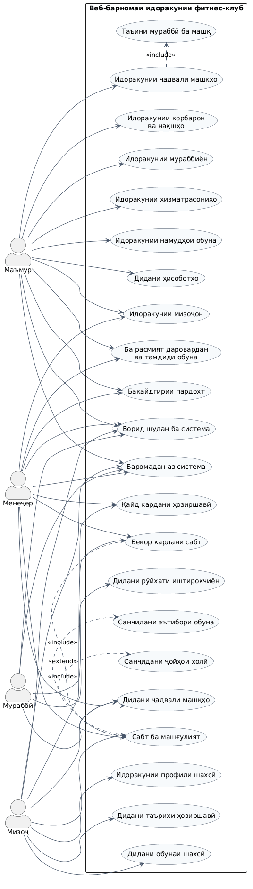
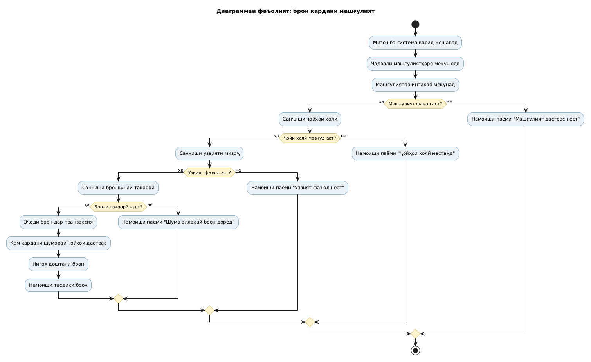
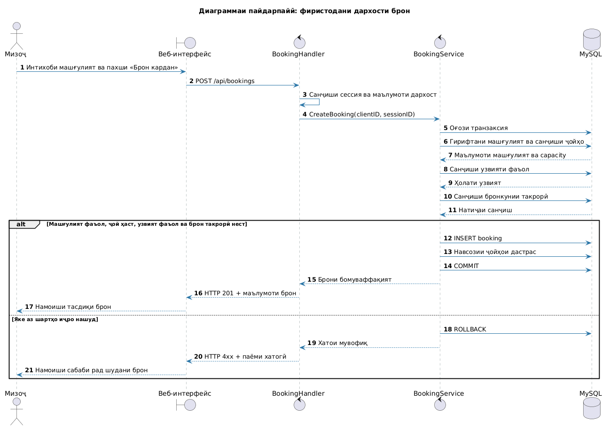
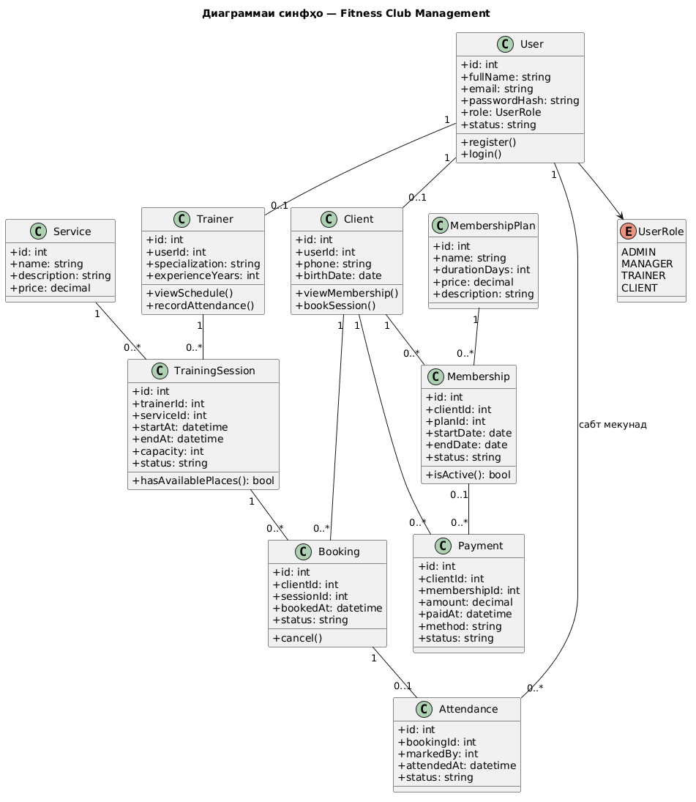
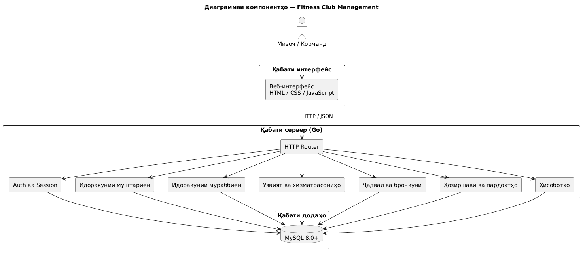

# СУПОРИШИ ТЕХНИКӢ
## барои таҳияи веб-барномаи идоракунии фитнес-клуб

**Номи кӯтоҳ:** FCMS (Fitness Club Management System)  
**Версия:** 1.0  
**Сана:** 16.11.2026  
**Иҷрокунанда:** [Ному насаб], гурӯҳи [рақами гурӯҳ]  
**Фармоишгар:** фитнес-клуб (шартан)  
**Муҳлати иҷро:** семестри ҷорӣ мутобиқи нақшаи таълимӣ

---

# 1. Маълумоти умумӣ

## 1.1. Номи система
Номи пурраи система — **Fitness Club Management System (FCMS)**, веб-барномаи идоракунии фаъолияти фитнес-клуб.

## 1.2. Асос барои таҳия
Зарурати муттаҳид намудани маълумот дар бораи муштариён, мураббиён, намудҳои абонемент, хизматрасониҳо, машғулиятҳо, ҷадвали корӣ ва ҳозиршавии муштариён дар як низоми ягона мебошад. Система бояд амалиётҳои асосии фитнес-клубро автоматӣ карда, кори маъмурият ва мураббиёнро осон намояд.

## 1.3. Фармоишгар ва иҷрокунанда
Фармоишгари шартӣ — роҳбарият ва кормандони фитнес-клуб. Иҷрокунанда — донишҷӯ/таҳиягари лоиҳаи таълимӣ.

## 1.4. Истилоҳот ва мафҳумҳо
- **Фитнес-клуб** — муассисае, ки хизматрасониҳои варзишӣ ва машқҳои ҷисмониро пешниҳод мекунад.
- **Маъмур (ADMIN)** — корбаре, ки ҳуқуқи идоракунии умумии системаро дорад.
- **Менеҷер (MANAGER)** — корманде, ки муштариён, абонементҳо, пардохтҳо ва сабти номро идора мекунад.
- **Мураббӣ (TRAINER)** — корманде, ки машғулиятҳоро мегузаронад ва ҳозиршавии муштариёнро қайд мекунад.
- **Муштарӣ (CLIENT)** — шахсе, ки аз хизматрасониҳои фитнес-клуб истифода мебарад.
- **Абонемент** — ҳуқуқи муштарӣ барои истифодаи хизматрасониҳои клуб дар муҳлати муайян ё бо шумораи муайяни ташрифҳо.
- **Машғулият** — машқи гурӯҳӣ ё инфиродӣ бо сана, вақт ва мураббии муайян.
- **Бақайдгирӣ (Booking)** — сабти муштарӣ ба машғулият.
- **MVP** — версияи аввалияи дорои имкониятҳои асосии корӣ.
- **ТФ/ҒТФ** — талаботи функсионалӣ ва ғайрифунксионалӣ.

# 2. Таъинот ва мақсадҳои сохтани система

## 2.1. Таъинот
FCMS веб-барномаест, ки барои автоматӣ намудани равандҳои асосии фитнес-клуб пешбинӣ шудааст. Маъмур метавонад корбарон, кормандон, хизматрасониҳо ва танзимоти системаро идора кунад. Менеҷер муштариён, абонементҳо ва сабти номро назорат мекунад. Мураббӣ ҷадвали машғулиятҳо ва рӯйхати иштирокчиёнро мебинад. Муштарӣ метавонад хизматрасониҳоро аз назар гузаронад, ҳолати абонементи худро тафтиш кунад ва ба машғулиятҳо сабти ном намояд.

## 2.2. Мақсадҳои ченшаванда
1. Маълумот дар бораи муштариён, мураббиён, абонементҳо ва машғулиятҳо дар як пойгоҳи додаҳо нигоҳ дошта шавад.
2. Ҷустуҷӯи одии муштарӣ дар муҳити санҷишӣ на бештар аз 3 сония вақт гирад.
3. Система муҳлати амали абонемент ва шумораи ташрифҳои боқимондаро назорат кунад.
4. Муштарӣ танҳо ба машғулияти дорои ҷойи холӣ сабти ном шуда тавонад.
5. Барои як муштарӣ ба як машғулият сабти номҳои такрорӣ иҷозат дода нашавад.
6. Ҳуқуқи дастрасӣ ба амалиётҳои муҳофизатшуда дар тарафи сервер санҷида шавад.
7. Маълумоти ҳозиршавӣ ва таърихи тағйирёбии ҳолати сабти ном дар пойгоҳи додаҳо нигоҳ дошта шавад.

## 2.3. Ҳудуди лоиҳа
**Ба MVP дохил мешаванд:** бақайдгирӣ ва воридшавӣ; нақшҳои ADMIN, MANAGER, TRAINER ва CLIENT; идоракунии профил; идоракунии муштариён ва мураббиён; намудҳои абонемент; додан ва тамдид кардани абонемент; идоракунии хизматрасониҳо; ҷадвали машғулиятҳо; сабти муштариён ба машғулиятҳо; санҷиши ҷойҳои холӣ; баҳисобгирии ҳозиршавӣ; панели идоракунӣ ва ҳисоботи одӣ.

**Берун аз доираи MVP (Won't):** барномаи алоҳидаи мобилӣ; пайвастшавии ҳатмӣ ба низоми бонкии пардохт; ҳамгироӣ бо CRM-и беруна; назорати дастрасӣ тавассути таҷҳизоти биометрӣ; таҳлили пешрафтаи фаъолияти варзишӣ; системаи мураккаби тахфифҳо ва бонусҳо. Нигоҳдории маълумоти пардохт дар пойгоҳи додаҳо метавонад пешбинӣ шавад, аммо пайвастшавӣ ба провайдери воқеии пардохт ба марҳилаи алоҳида тааллуқ дорад.

# 3. Тавсифи объекти автоматизатсия

## 3.1. Объекти автоматизатсия
Объекти автоматизатсия фаъолияти ҳаррӯзаи фитнес-клуб мебошад: бақайдгирии муштариён, идоракунии кормандон, пешниҳоди хизматрасониҳо, фурӯш ва назорати абонементҳо, банақшагирии машғулиятҳо, сабти ном ва баҳисобгирии ҳозиршавӣ. Система барои идоракунии як фитнес-клуб пешбинӣ шудааст.

## 3.2. Иштирокчиёни система

| Нақш | Вазифаҳо |
|---|---|
| ADMIN | Идоракунии корбарон ва нақшҳо, танзимоти система, хизматрасониҳо, мураббиён, муштариён ва назорати умумӣ |
| MANAGER | Бақайдгирии муштариён, додан ва тамдид кардани абонементҳо, идоракунии сабти ном ва пардохтҳо |
| TRAINER | Дидани ҷадвали шахсӣ, рӯйхати иштирокчиёни машғулият ва қайд кардани ҳозиршавӣ |
| CLIENT | Дидани хизматрасониҳо ва ҷадвал, дидани абонементи худ, сабти ном ба машғулиятҳо ва дидани таърихи ташрифҳо |

## 3.3. Равандҳои асосӣ
**Бақайдгирии корбар:** корбар маълумоти заруриро ворид мекунад; сервер майдонҳои ҳатмӣ ва такрор нашудани email ё номи корбарро месанҷад; рамз дар шакли hash нигоҳ дошта мешавад; пас аз воридшавӣ нақши корбар муайян мегардад.

**Бақайдгирии муштарӣ:** менеҷер маълумоти шахсии муштариро ворид мекунад; система дурустии маълумот ва такрор набудани сабтро месанҷад; пас аз тасдиқ профили муштарӣ сабт мешавад.

**Оформлениеи абонемент:** менеҷер намуди абонементро интихоб мекунад; система арзиш, санаи оғоз, санаи анҷом ва шумораи ташрифҳоро муайян мекунад; маълумоти абонемент ба муштарӣ вобаста карда мешавад.

**Илова кардани машғулият:** маъмур ё корманди дорои ҳуқуқ сана, вақт, давомнокӣ, мураббӣ, намуд ва иқтидори машғулиятро муайян мекунад; сервер дурустии маълумот ва мувофиқати ҷадвалро месанҷад.

**Сабти ном ба машғулият:** муштарӣ машғулият ва вақтро интихоб мекунад; сервер фаъол будани абонемент, мавҷуд будани ҷойи холӣ ва набудани сабти такрориро месанҷад; агар шартҳо иҷро шаванд, сабти ном дар транзаксияи пойгоҳи додаҳо нигоҳ дошта мешавад.

**Баҳисобгирии ҳозиршавӣ:** мураббӣ ё менеҷер рӯйхати иштирокчиёнро мекушояд ва ҳозир ё ғоиб будани муштариро қайд мекунад; система натиҷаро дар таърихи ташрифҳо нигоҳ медорад.

## 3.4. Луғати соҳаи предметӣ

| Мафҳум | Маъно |
|---|---|
| Абонементи фаъол | Абонементе, ки муҳлати амали он ба анҷом нарасидааст ва ҳолаташ фаъол мебошад |
| Абонементи муҳлаташ гузашта | Абонементе, ки санаи анҷомаш гузаштааст |
| Намуди абонемент | Маҷмӯи шартҳо: нарх, муҳлат ва шумораи ташрифҳо |
| Машғулияти гурӯҳӣ | Машқе, ки барои якчанд муштарӣ дар вақти муайян гузаронида мешавад |
| Машғулияти инфиродӣ | Машқ бо иштироки як муштарӣ ва мураббии муайян |
| Ҷойи холӣ | Ҷойи дастрас дар машғулият бо назардошти иқтидори умумӣ |
| Сабти ном | Дархости муштарӣ барои иштирок дар машғулият |
| Ҳозиршавӣ | Маълумот дар бораи иштирок ё иштирок накардани муштарӣ |
| Пардохт | Амалиёти молиявии вобаста ба абонемент ё хизматрасонӣ |

## 3.5. Фарқият аз қарорҳои монанд
Хусусияти асосии FCMS муттаҳид намудани равандҳои дохилии фитнес-клуб дар як веб-барнома мебошад. Система маълумоти муштарӣ, абонемент, ҷадвали мураббӣ, сабти ном ва ҳозиршавиро бо ҳам алоқаманд мекунад. Ин имкон медиҳад, ки кормандон маълумоти заруриро аз як манбаъ гиранд ва амалиётҳои такрории дастиро кам намоянд.

# 4. Талабот ба система

## 4.1. Талабот ба система дар маҷмӯъ

**Меъморӣ**
- Меъмории клиент-серверӣ истифода мешавад.
- Backend бо забони Go таҳия мегардад.
- Frontend бо HTML, CSS ва JavaScript сохта мешавад.
- Барои нигоҳдории маълумот MySQL истифода мешавад; XAMPP метавонад дар муҳити маҳаллӣ истифода гардад.
- Қабатҳои API, аутентификатсия, мантиқи бизнес ва дастрасӣ ба маълумот аз ҳам ҷудо карда мешаванд.
- Мубодилаи маълумот байни frontend ва backend тавассути HTTP/JSON API амалӣ мегардад.

**Эътимоднокӣ**
- Амалиётҳои муҳими вобаста ба абонемент, пардохт, сабти ном ва ҳозиршавӣ бояд бо истифода аз транзаксия иҷро шаванд.
- Ҳангоми хатогӣ амалиёти нотамом бо `ROLLBACK` бекор карда шавад.
- Нусхаи эҳтиётии пойгоҳи додаҳо мунтазам сохта шавад.
- Имконияти барқарорсозии маълумот аз нусхаи эҳтиётӣ санҷида шавад.

**Амният**
- Рамзҳо танҳо дар шакли hash нигоҳ дошта шаванд.
- Ҳуқуқи корбарон дар тарафи сервер санҷида шавад.
- CLIENT танҳо маълумоти шахсӣ ва сабтҳои ба худ тааллуқдоштаро бинад.
- TRAINER танҳо ҷадвал ва машғулиятҳои ба ӯ вобастаро идора кунад.
- MANAGER танҳо амалиётҳои дар доираи нақши худ иҷозатдодашударо иҷро кунад.
- Маълумоти воридшаванда санҷида шавад.
- Дар муҳити истеҳсолӣ HTTPS истифода шавад.
- Рамзҳо ва калидҳои махфӣ дар GitHub ҷойгир карда нашаванд.

**Самаранокӣ**
- Ҷустуҷӯи одии муштарӣ дар муҳити санҷишӣ на бештар аз 3 сония вақт гирад.
- Дархостҳои ҳамзамон набояд боиси сабти такрорӣ ба як машғулият ё зиёд шудани иқтидори он гарданд.
- Санҷиши ҷойҳои холӣ ва сабти ном дар тарафи сервер иҷро карда шавад.

**Нигоҳдорӣ ва рушд**
- Код бояд сохтори модулӣ дошта бошад.
- Танзимоти муҳит аз коди барнома ҷудо нигоҳ дошта шавад.
- Тағйироти пойгоҳи додаҳо тавассути migration идора карда шаванд.
- Дастури насб ва оғоз дар файли README ҷойгир карда шавад.
- Тағйироти код тавассути Git назорат карда шаванд.

## 4.2. Талаботи функсионалӣ

| Рамз | Функсия | Тавсиф | Афзалият |
|---|---|---|---|
| ТФ-01 | Бақайдгирӣ | Сохтани ҳисоби корбар ва санҷиши ягонагии email/username | Must |
| ТФ-02 | Воридшавӣ/баромад | Оғоз ва анҷом додани сессияи корбар | Must |
| ТФ-03 | Профил | Дидан ва таҳрир кардани маълумоти иҷозатдодашудаи шахсӣ | Should |
| ТФ-04 | Нақшҳо | Таъин ва идоракунии нақшҳои ADMIN, MANAGER, TRAINER ва CLIENT | Must |
| ТФ-05 | Идоракунии муштариён | Илова, дидан, таҳрир ва ғайрифаъол кардани маълумоти муштарӣ | Must |
| ТФ-06 | Идоракунии мураббиён | Илова ва таҳрири маълумоти мураббӣ, ихтисос ва маълумоти тамос | Must |
| ТФ-07 | Намудҳои абонемент | Сохтан ва таҳрири намудҳои абонемент, нарх ва шартҳо | Must |
| ТФ-08 | Абонементҳо | Оформление, тамдид ва назорати муҳлати амали абонемент | Must |
| ТФ-09 | Хизматрасониҳо | Илова, таҳрир ва ғайрифаъол кардани хизматрасониҳои клуб | Should |
| ТФ-10 | Ҷадвали машғулиятҳо | Сохтан ва таҳрири машғулиятҳо, сана, вақт ва мураббӣ | Must |
| ТФ-11 | Иқтидори машғулият | Муайян кардани шумораи ҷойҳои дастрас ва назорати он | Must |
| ТФ-12 | Сабти ном | Сабти муштарӣ ба машғулияти дастрас | Must |
| ТФ-13 | Идоракунии сабти ном | Дидан, тасдиқ ва бекор кардани сабти ном мутобиқи ҳуқуқ | Must |
| ТФ-14 | Ҳозиршавӣ | Қайд кардани ҳозир ё ғоиб будани муштарӣ | Must |
| ТФ-15 | Пардохтҳо | Нигоҳдорӣ ва дидани маълумоти пардохт | Should |
| ТФ-16 | Ҳисобот | Намоиши маълумоти ҷамъбастӣ дар бораи муштариён, абонементҳо ва машғулиятҳо | Should |
| ТФ-17 | Огоҳиномаҳо | Нигоҳдорӣ ва намоиши огоҳиномаҳои дохилӣ | Could |
| ТФ-18 | Ҷустуҷӯ | Ҷустуҷӯи муштариён ва филтркунии машғулиятҳо | Must |

### Ҳикояҳои корбар (User Stories)

1. **US-01 (Must):** Ҳамчун корбари нав, мехоҳам ҳисоб созам, то аз имкониятҳои система истифода барам.  
   **Меъёри қабул:** email-и такрорӣ қабул намешавад; рамз дар шакли hash нигоҳ дошта мешавад.

2. **US-02 (Must):** Ҳамчун менеҷер, мехоҳам муштарии навро сабт кунам, то маълумоти ӯ дар система нигоҳ дошта шавад.  
   **Меъёри қабул:** майдонҳои ҳатмӣ санҷида мешаванд ва муштарии такрорӣ ба қайд гирифта намешавад.

3. **US-03 (Must):** Ҳамчун менеҷер, мехоҳам ба муштарӣ абонемент диҳам, то муҳлат ва шумораи ташрифҳои ӯ назорат шаванд.  
   **Меъёри қабул:** санаи анҷом аз санаи оғоз пештар буда наметавонад; абонемент ба муштарии дуруст вобаста мешавад.

4. **US-04 (Must):** Ҳамчун маъмур, мехоҳам машғулият ва мураббиро ба ҷадвал илова кунам.  
   **Меъёри қабул:** вақти анҷом аз вақти оғоз дертар бошад ва мураббӣ дар ҳамон вақт машғулияти дигар надошта бошад.

5. **US-05 (Must):** Ҳамчун муштарӣ, мехоҳам машғулиятҳои дастрасро бинам ва ба яке аз онҳо сабти ном шавам.  
   **Меъёри қабул:** танҳо машғулияти дорои ҷойи холӣ дастрас аст; сабти такрорӣ иҷозат дода намешавад.

6. **US-06 (Must):** Ҳамчун мураббӣ, мехоҳам ҷадвал ва рӯйхати иштирокчиёни машғулиятҳои худро бинам.  
   **Меъёри қабул:** мураббӣ танҳо маълумоти машғулиятҳои ба ӯ вобастаро мебинад.

7. **US-07 (Must):** Ҳамчун мураббӣ ё менеҷер, мехоҳам ҳозиршавии муштариёнро қайд кунам.  
   **Меъёри қабул:** барои як сабти ном танҳо ҳолати иҷозатдодашудаи ҳозиршавӣ сабт мешавад ва таърихи он нигоҳ дошта мешавад.

8. **US-08 (Should):** Ҳамчун муштарӣ, мехоҳам ҳолати абонемент ва таърихи ташрифҳои худро бинам.  
   **Меъёри қабул:** танҳо маълумоти ба ҳисоби худи муштарӣ тааллуқдошта намоиш дода мешавад.

### Матритсаи дастрасӣ «нақш × функсия»

| Функсия | ADMIN | MANAGER | TRAINER | CLIENT |
|---|---|---|---|---|
| Дидани панели умумӣ | Ҳа | Маҳдуд | Не | Не |
| Идоракунии профили шахсӣ | Ҳа | Ҳа | Ҳа | Ҳа |
| Идоракунии корбарон ва нақшҳо | Ҳа | Не | Не | Не |
| Идоракунии муштариён | Ҳа | Ҳа | Дидани иштирокчиён | Танҳо профили худ |
| Идоракунии мураббиён | Ҳа | Маҳдуд | Танҳо профили худ | Дидани маълумоти дастрас |
| Идоракунии намудҳои абонемент | Ҳа | Ҳа | Не | Дидан |
| Оформление ва тамдиди абонемент | Ҳа | Ҳа | Не | Не |
| Идоракунии хизматрасониҳо | Ҳа | Маҳдуд | Не | Дидан |
| Идоракунии ҷадвал | Ҳа | Ҳа | Машғулиятҳои худ | Дидан |
| Сабти ном ба машғулият | Назорат | Назорат | Дидан | Ҳа |
| Қайд кардани ҳозиршавӣ | Ҳа | Ҳа | Машғулиятҳои худ | Не |
| Дидани пардохтҳо | Ҳама | Дар доираи ҳуқуқ | Не | Танҳо пардохтҳои худ |
| Ҳисобот | Ҳа | Маҳдуд | Не | Не |

Ҳамаи ҳуқуқҳо бояд дар API ва тарафи сервер санҷида шаванд. Танҳо пинҳон кардани тугмаҳо дар интерфейс барои ҳифзи маълумот кофӣ нест.

## 4.3. Талабот ба намудҳои таъминот
- **Таъминоти иттилоотӣ:** пойгоҳи додаҳои FCMS бо ҷадвалҳои асосии `users`, `clients`, `trainers`, `membership_types`, `memberships`, `services`, `training_sessions`, `bookings`, `attendance` ва `payments`; муҳаррики InnoDB; рамзгузории `utf8mb4`; калидҳои PK/FK, маҳдудиятҳои UNIQUE ва CHECK, инчунин индексҳо.
- **Таъминоти барномавӣ:** Go, HTML5, CSS3, JavaScript, MySQL, Git/GitHub, PlantUML; API дар асоси HTTP/JSON ва HTTPS дар муҳити истеҳсолӣ.
- **Таъминоти техникӣ:** компютери таҳиягар бо Go, VS Code, Git ва MySQL/XAMPP; барои ҷойгиркунӣ сервер бо захираҳои кофии CPU, RAM ва SSD. Конфигуратсияи дақиқ ҳангоми ҷойгиркунӣ муайян карда мешавад.
- **Таъминоти забонӣ:** интерфейс ва дастурҳои корбарӣ бо забони тоҷикӣ; нигоҳдорӣ ва ҷустуҷӯи матни кириллӣ бе вайроншавии рамзҳо.
- **Таъминоти ташкилӣ:** дастурҳои алоҳида барои ADMIN, MANAGER, TRAINER ва CLIENT; тағйирот дар Git сабт шуда, версияҳои устувор бо tag ишора карда мешаванд.

# 5. Моделҳои система

Диаграммаҳо дар формати PNG бояд дар роҳҳои дар поён нишон додашуда ҷойгир карда шаванд. Агар номи воқеии файлҳо дар репозиторий фарқ кунад, истинодҳоро мувофиқи номҳои мавҷуда иваз намоед.

## 5.1. Диаграммаи ҳолатҳои истифода (Use Case)

**Расми 1.** Дар диаграмма чор нақши асосӣ — ADMIN, MANAGER, TRAINER ва CLIENT — нишон дода мешаванд. Муштарӣ хизматрасониҳоро мебинад ва ба машғулият сабти ном мешавад; менеҷер муштариён ва абонементҳоро идора мекунад; мураббӣ ҷадвал ва ҳозиршавиро назорат мекунад; маъмур ҳуқуқи идоракунии умумӣ дорад.

## 5.2. Раванди сабти ном ба машғулият — Activity

**Расми 2.** Раванд аз интихоби машғулият оғоз мешавад. Система фаъол будани абонемент, мавҷудияти ҷойи холӣ ва набудани сабти такрориро месанҷад. Агар шартҳо иҷро шаванд, сабти ном нигоҳ дошта мешавад; дар акси ҳол дархост рад мегардад.

## 5.3. Пайдарпайии сабти ном — Sequence

**Расми 3.** Муносибати байни муштарӣ, интерфейс, API, Booking Service ва MySQL нишон дода мешавад. Санҷиш ва нигоҳдории сабти ном дар транзаксия иҷро мегарданд; ҳангоми хатогӣ `ROLLBACK` истифода мешавад.

## 5.4. Диаграммаи синфҳо (Class Diagram)

**Расми 4.** Синфҳои User, Client, Trainer, MembershipType, Membership, Service, TrainingSession, Booking, Attendance ва Payment, инчунин робитаи байни онҳо нишон дода мешаванд.

## 5.5. Диаграммаи компонентҳо (Component Diagram)

**Расми 5.** Интерфейси веб, REST API, модули аутентификатсия, модули муштариён, абонементҳо, ҷадвал, сабти ном, ҳозиршавӣ ва қабати дастрасӣ ба пойгоҳи додаҳо ҳамчун компонентҳои алоҳида нишон дода мешаванд.

## 5.6. Диаграммаи ER

**Расми 6.** Ҷадвалҳои асосии пойгоҳи додаҳо ва робитаҳои 1:N ва 1:1 нишон дода мешаванд. Калидҳои хориҷӣ муштариён, мураббиён, абонементҳо, машғулиятҳо, сабти ном, ҳозиршавӣ ва пардохтҳоро бо ҳам мепайванданд.

## 5.7. Диаграммаи ҷойгиркунӣ (Deployment Diagram)

**Расми 7.** Дастгоҳи корбар, браузер, сервери барнома, REST API, сервери пойгоҳи додаҳо ва муҳити ҷойгиркунӣ нишон дода мешаванд. Корбар тавассути браузер ба барнома пайваст мешавад; сервери барнома бо MySQL тавассути SQL ҳамкорӣ мекунад.

### Пайгирии User Story то ҷадвалҳои пойгоҳи додаҳо

| Ҳикоя | Модел/раванд | Ҷадвалҳои БД |
|---|---|---|
| US-01 Бақайдгирӣ | Use Case/Sequence Register | `users` |
| US-02 Иловаи муштарӣ | Use Case Manage Client | `users`, `clients` |
| US-03 Абонемент | Use Case Manage Membership | `clients`, `membership_types`, `memberships` |
| US-04 Ҷадвали машғулият | Use Case Manage Schedule | `trainers`, `services`, `training_sessions` |
| US-05 Сабти ном | Activity/Sequence Booking | `clients`, `memberships`, `training_sessions`, `bookings` |
| US-06 Ҷадвали мураббӣ | Use Case View Schedule | `trainers`, `training_sessions`, `bookings` |
| US-07 Ҳозиршавӣ | Activity Attendance | `bookings`, `attendance`, `memberships` |
| US-08 Таърихи муштарӣ | Use Case View History | `clients`, `memberships`, `bookings`, `attendance`, `payments` |

# 6. Таркиб ва мазмуни корҳои таҳия

| Марҳила | Корҳо | Натиҷа | Муҳлат |
|---|---|---|---|
| 1. Тарҳрезӣ | Таҳлили соҳаи предметӣ, супориши техникӣ, моделҳо ва БД | Ҳуҷҷатҳо ва схемаи БД | Мувофиқи нақша |
| 2. Дизайн | UX/UI ва прототип | Макет ва прототип | Мувофиқи нақша |
| 3. Frontend | Таҳияи HTML/CSS/JS | Саҳифаҳои интерфейс | Мувофиқи нақша |
| 4. Backend | Go API, аутентификатсия, БД ва мантиқи бизнес | MVP-и коркунанда | Мувофиқи нақша |
| 5. Санҷиш | Тест-кейсҳо ва ислоҳи хатогиҳо | Ҳисоботи санҷиш | Мувофиқи нақша |
| 6. Ҷойгиркунӣ | Танзими сервер, HTTPS ва нусхаи эҳтиётӣ | Версияи ҷойгиршуда | Мувофиқи нақша |

Муҳлатҳои тақвимӣ бояд бо ҷадвали дарсии гурӯҳ мувофиқа карда шаванд.

# 7. Тартиби назорат ва қабул

## 7.1. Санҷишҳо
1. Санҷиши функсионалии ҳамаи талаботи Must бо ҳисобҳои ADMIN, MANAGER, TRAINER ва CLIENT.
2. Санҷиши ҳуқуқ: CLIENT наметавонад маълумоти шахсии муштарии дигарро тағйир диҳад.
3. Санҷиши ҳуқуқи мураббӣ: TRAINER наметавонад машғулияти ба ӯ вобастанабударо идора кунад.
4. Санҷиши абонемент: абонементи фаъол иҷозати истифода медиҳад; абонементи муҳлаташ гузашта ё ғайрифаъол сабти номро маҳдуд мекунад.
5. Санҷиши иқтидор: ҳангоми пур шудани ҷойҳо сабти нави ном рад карда мешавад.
6. Санҷиши сабти такрорӣ: як муштарӣ ба як машғулият ду маротиба сабт шуда наметавонад.
7. Санҷиши транзаксия: ҳангоми хатогӣ маълумоти нопурра дар пойгоҳи додаҳо нигоҳ дошта нашавад.
8. Санҷиши БД: schema/migrations ва seed бе хатогӣ иҷро шаванд; FK, UNIQUE ва CHECK дуруст кор кунанд.
9. Санҷиши самаранокӣ: ҷустуҷӯи одӣ дар муҳити санҷишӣ на бештар аз 3 сония иҷро шавад.
10. Санҷиши амният: рамзҳо дар шакли кушода нигоҳ дошта нашаванд ва endpoint-и муҳофизатшуда бе иҷозат дастрас набошад.

## 7.2. Намунаҳои тест-кейсҳо

| ID | Амали санҷидашаванда | Натиҷаи интизоршаванда |
|---|---|---|
| TC-01 | Бақайдгирӣ бо email-и нав | Ҳисоби корбар сохта мешавад |
| TC-02 | Бақайдгирӣ бо email-и такрорӣ | Дархост рад карда мешавад |
| TC-03 | Воридшавӣ бо рамзи нодуруст | Воридшавӣ рад карда мешавад |
| TC-04 | MANAGER муштарии нав илова мекунад | Маълумоти муштарӣ нигоҳ дошта мешавад |
| TC-05 | MANAGER абонемент медиҳад | Абонемент ба муштарии дуруст вобаста мешавад |
| TC-06 | ADMIN машғулият илова мекунад | Машғулият дар ҷадвал пайдо мешавад |
| TC-07 | CLIENT ба машғулияти дорои ҷойи холӣ сабт мешавад | Сабти ном нигоҳ дошта мешавад |
| TC-08 | CLIENT ба машғулияти пуршуда сабт мешавад | Дархост рад карда мешавад |
| TC-09 | CLIENT ба як машғулият такроран сабт мешавад | Сабти такрорӣ рад карда мешавад |
| TC-10 | TRAINER ҳозиршавиро қайд мекунад | Маълумоти ҳозиршавӣ сабт мешавад |
| TC-11 | CLIENT маълумоти муштарии дигарро мекушояд | Дастрасӣ манъ карда мешавад |
| TC-12 | Иҷрои schema ва seed | SQL бе хатогӣ иҷро мешавад |
| TC-13 | Абонементи муҳлаташ гузашта | Сабти ном ба машғулият иҷозат дода намешавад |
| TC-14 | Барқарор кардани нусхаи эҳтиётӣ | Маълумот барқарор карда мешавад |

## 7.3. Меъёрҳои қабул
Система қабулшуда ҳисобида мешавад, агар 100% талаботи Must иҷро шуда бошанд; санҷиши ҳуқуқи дастрасӣ бомуваффақият гузашта бошад; абонементҳо ва сабти ном дуруст кор кунанд; иқтидори машғулият вайрон нашавад; migration/schema ва seed бе хатогӣ иҷро шаванд; хатогиҳои муҳим боқӣ намонанд; README ва дастури ҷойгиркунӣ пешниҳод шуда бошанд.

# 8. Талабот ба ҳуҷҷатгузорӣ

1. `README.md` — тавсифи лоиҳа, талабот ба муҳит ва дастури оғоз.
2. `docs/01-domain-analysis.md` — таҳлили соҳаи предметӣ.
3. `docs/02-comparison-matrix.md` — муқоисаи системаҳои монанд.
4. `docs/03-short-spec.md` — супориши техникии кӯтоҳ ва ҳикояҳои корбар.
5. `docs/04-use-cases/` — диаграммаҳои Use Case, Activity ва Sequence бо файлҳои PlantUML.
6. `docs/05-architecture/` — диаграммаҳои Class ва Component.
7. `docs/06-architecture/` — ҳуҷҷатҳои меъморӣ ва диаграммаи ҷойгиркунӣ.
8. `docs/07-database/` — модели мантиқӣ ва ER-диаграмма.
9. `database/schema.sql` ё migration-ҳо — сохтори физикии пойгоҳи додаҳо.
10. `database/seed.sql` — маълумоти санҷишӣ.
11. `database/queries.sql` — дархостҳои SQL.
12. `docs/08-technical-specification.md` — ҳуҷҷати мазкур.
13. `docs/09-api.md` — тавсифи REST API ва endpoint-ҳо.
14. `docs/10-ui-design/` — макетҳо ва тасвирҳои интерфейс.
15. `docs/15-test-cases.md` — тест-кейсҳо ва натиҷаҳои санҷиш.
16. `docs/16-deploy.md` — дастури ҷойгиркунӣ.
17. Дастури кӯтоҳи корбар барои ADMIN, MANAGER, TRAINER ва CLIENT.

Супориши техникӣ бояд ҳуҷҷати мустақил бошад; истинод ба файлҳои дигар набояд ҷойгузини тавсифи худи талабот гардад.

# 9. Манбаъҳои таҳия

1. ГОСТ 34.602 — таркиб ва мазмуни супориши техникӣ барои системаи автоматиконидашуда.
2. Ҳуҷҷатҳои таҳлили соҳаи предметӣ ва талаботи лоиҳаи FCMS.
3. Модели мантиқии пойгоҳи додаҳои FCMS.
4. Диаграммаҳои меъморӣ ва ҷойгиркунии FCMS.
5. Ҳуҷҷатҳои расмии Go: https://go.dev/doc/
6. Ҳуҷҷатҳои расмии MySQL: https://dev.mysql.com/doc/
7. Ҳуҷҷатҳои Git: https://git-scm.com/doc
8. Ҳуҷҷатҳои PlantUML: https://plantuml.com/

---

## Замимаи А. Қарорҳои муҳими лоиҳавӣ

- FCMS барои автоматиконии фаъолияти як фитнес-клуб пешбинӣ шудааст.
- ADMIN ҳуқуқи идоракунии умумии системаро дорад.
- MANAGER муштариён, абонементҳо ва сабти номро дар доираи ҳуқуқи худ идора мекунад.
- TRAINER ҷадвал ва машғулиятҳои ба ӯ вобастаро мебинад ва ҳозиршавиро қайд мекунад.
- CLIENT танҳо маълумоти шахсӣ, абонемент ва сабтҳои ба худ тааллуқдоштаро мебинад.
- Абонемент бояд санаи оғоз, санаи анҷом, ҳолат ва дар ҳолати зарурат шумораи ташрифҳои боқимондаро дошта бошад.
- Сабти ном ба машғулият танҳо ҳангоми фаъол будани абонемент ва мавҷуд будани ҷойи холӣ иҷозат дода мешавад.
- Барои як муштарӣ ба як машғулият сабти такрорӣ иҷозат дода намешавад.
- Пардохт аз ҳолати абонемент ва ҳолати сабти ном ҷудо нигоҳ дошта мешавад.
- Пайвастшавӣ ба провайдери пардохт ва хизматрасонии Email/SMS ба марҳилаи алоҳида тааллуқ дорад.
- Номҳои файлҳои PNG дар боби 5 бояд бо номҳои воқеии файлҳои репозиторий мувофиқ карда шаванд.

## Замимаи Б. Нақшаи ҳимояи Р-1 (5–7 дақиқа)

- **2 дақиқа:** мавзӯъ, масъалаи мавҷуда, мақсади система ва чор нақши асосӣ.
- **2 дақиқа:** пайгирии US-05: Use Case → Activity/Sequence → ҷадвалҳои `clients`, `memberships`, `training_sessions`, `bookings`.
- **1 дақиқа:** иҷрои schema/migration, seed ва як дархости SQL.
- **1–2 дақиқа:** ҷавоб ба саволҳои назариявӣ ва шарҳи қарорҳои лоиҳавӣ.

### Саволҳои эҳтимолии омӯзгор

**1. Супориши техникии пурра аз супориши техникии кӯтоҳ чӣ фарқ дорад?**  
Супориши техникии кӯтоҳ асосан ҳудуд ва вазифаҳои системаро муайян мекунад. Супориши техникии пурра инчунин талаботи ғайрифунксионалӣ, намудҳои таъминот, моделҳо, марҳилаҳои иҷро, санҷиш ва меъёрҳои қабулро дар бар мегирад.

**2. Матритсаи дастрасӣ барои чӣ лозим аст?**  
Он ҳуқуқи ҳар як нақшро нисбат ба функсияҳои система муайян мекунад. Дар код ин ҳуқуқҳо тавассути middleware ва санҷиши нақши корбар дар тарафи сервер амалӣ мешаванд.

**3. Чӣ тавр сабти ном ба машғулияти пуршуда пешгирӣ карда мешавад?**  
Сервер шумораи сабтҳои фаъолро бо иқтидори машғулият муқоиса мекунад. Санҷиш ва илова кардани сабти нав дар транзаксия иҷро мешаванд, то шумораи ҷойҳо аз ҳад зиёд нашавад.

**4. Чаро `membership_types` ва `memberships` ҷадвалҳои алоҳида мебошанд?**  
`membership_types` намуд ва шартҳои умумии абонементро нигоҳ медорад, аммо `memberships` абонементи мушаххасеро, ки ба муштарӣ дода шудааст, нигоҳ медорад. Ин такрори маълумотро кам мекунад.

**5. Чаро `attendance` ҷадвали алоҳида дорад?**  
Зеро сабти ном ва ҳозиршавӣ мафҳумҳои гуногунанд. Сабти ном нияти иштирокро нишон медиҳад, аммо `attendance` воқеан ҳозир ё ғоиб будани муштариро сабт мекунад.

**6. Чаро нақшҳои корбарон ҷудо карда мешаванд?**  
Ҳар як гурӯҳи корбар вазифа ва ҳуқуқҳои гуногун дорад. Ҷудо кардани нақшҳо амниятро беҳтар намуда, дастрасии нолозимро маҳдуд мекунад.

**7. Чаро бахши Won't муҳим аст?**  
Он муайян мекунад, ки кадом имкониятҳо ба версияи ҷорӣ дохил намешаванд. Ин барои идора кардани ҳаҷми кор ва пешгирии зиёд шудани беасоси вазифаҳои лоиҳа зарур аст.
